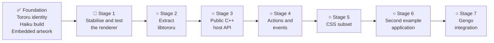

<h1 align="center">Tororu</h1>

<p align="center">
  
  
  
</p>

Tororu is a lightweight, Haiku-native HTML application framework and document
viewer. It continues the original FlyingTroll project and develops its small
HTML engine into `libtororu`: an alternative to Chromium-based application
frameworks that stays close to the Haiku API and native C++.

The Tororu browser is the first application built on the engine. It remains a
useful local-documentation viewer while also serving as the reference host for
the framework.


## Current status

Version v0.2 establishes the Tororu source tree from the preserved
FlyingTroll code, with Tororu application metadata and a separate Tororu
settings directory. The original source remains unchanged under
`FlyingTroll-Original/` for comparison and attribution.

Tororu currently supports:

- local HTML and plain-text files;
- back and forward history;
- bookmarks stored in `~/config/settings/Tororu/Bookmarks`;
- in-page text search;
- built-in Gengo language help;
- basic HTML text, links, images, tables, and character-set conversion.

The exact compatibility baseline and manual rendering fixture are documented
in [`docs/HTML_SUPPORT.md`](docs/HTML_SUPPORT.md).

## Project goals

- Develop the FlyingTroll HTML engine into a reusable `libtororu` library.
- Build the Tororu browser and document viewer entirely on that public library.
- Provide a native C++ API for creating windows, loading files or bundled
  markup, registering actions, receiving events, and exposing selected native
  functions to the interface.
- Add a declarative action bridge between markup and application code without
  granting markup unrestricted access to native functions.
- Implement a practical CSS subset suited to native application interfaces.
- Prove the framework with a second, focused example application.
- Integrate Gengo as Tororu's scripting layer once its language, runtime,
  permissions, and host interface have been specified.
- Remain lightweight and Haiku-native: Tororu will not embed Chromium.

## Development tracker



Legend: ✅ complete · 🚧 active · ○ planned

### Milestones

- [x] **Foundation**
  - [x] Preserve the original FlyingTroll source as a reference snapshot.
  - [x] Establish the Tororu application identity, versioning, and build.
  - [x] Embed browser artwork so the application launches independently.
- [ ] **Stage 1 — Stabilise and test the renderer**
  - [x] Record the currently supported HTML behaviour.
  - [x] Add representative rendering fixtures and repeatable smoke tests.
  - [ ] Cover malformed input, missing files, limits, and failure paths.
  - [ ] Remove renderer crashes, leaks, and unsafe fixed-size assumptions.
- [ ] **Stage 2 — Extract `libtororu`**
  - [ ] Separate document, layout, rendering, and browser-shell state.
  - [ ] Build the engine as an independently consumable library.
  - [ ] Make the Tororu browser a client of the library.
- [ ] **Stage 3 — Public C++ host API**
  - [ ] Introduce stable window, view, document, and resource interfaces.
  - [ ] Support files, in-memory markup, and bundled application resources.
  - [ ] Document ownership, errors, threading, and lifecycle behaviour.
- [ ] **Stage 4 — Actions and events**
  - [ ] Map declarative markup actions to explicitly registered handlers.
  - [ ] Deliver typed event data through a native message boundary.
  - [ ] Define permissions and prevent arbitrary native invocation.
- [ ] **Stage 5 — CSS subset**
  - [ ] Specify supported selectors, cascade rules, and properties.
  - [ ] Add box-model, typography, colour, spacing, and layout fixtures.
  - [ ] Keep unsupported CSS deterministic and safely ignored.
- [ ] **Stage 6 — Example application**
  - [ ] Build a focused application separate from the browser.
  - [ ] Exercise bundled markup, native actions, state, and resources.
  - [ ] Use its development to validate and refine the public API.
- [ ] **Stage 7 — Gengo integration**
  - [ ] Incorporate the forthcoming Gengo specification.
  - [ ] Connect Gengo through the same action and event boundary.
  - [ ] Define script lifecycle, permissions, errors, and debugging tools.

## Building on Haiku

Tororu uses Haiku's standard `makefile-engine` and requires a C++17-capable
Haiku development environment.

```sh
make
```

Toolbar images and built-in page artwork are embedded in the application, so
the resulting executable can be launched from any working directory.

To run the repository's platform-independent consistency checks:

```sh
make validate
```

## Source layout

- `src/` — active Tororu source and build definition.
- `artwork/` — high-resolution artwork sources and native Haiku icon assets.
- `FlyingTroll-Original/` — untouched upstream snapshot.
- `GENGO.md` — draft specification for the future Gengo scripting language.
- `scripts/validate.sh` — metadata and repository consistency checks.

## Heritage

FlyingTroll was written by Makitka in 2007 and described upstream as BSD/MIT
licensed. Tororu preserves that implementation while bringing it forward for
current Haiku systems.

